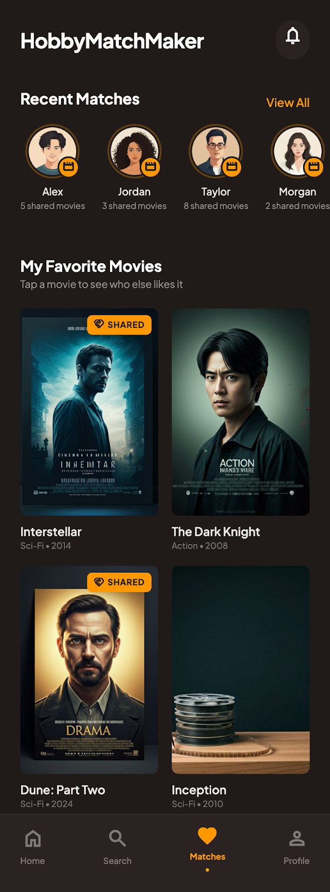
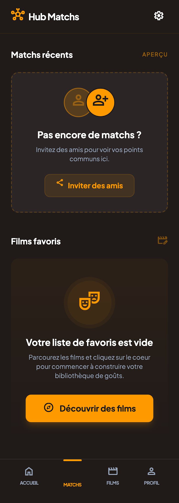

# Hub module

This module has for purpose to display two parts: recent matches and favorite hobby items.

## Features

- Display horizontal list of recent matches between user and any member from its social circle
- Display grid list of user's favorite hobby items
- Redirect to user profile when recent match list is empty
- Redirect to hobby item detail on item tapped on list

#### Design & UI

The interface must be developed with Compose Multiplatform, to the mock-ups below. Use and
enrich the shared `Design` module to create reusable components.

**1. Complete Hub (with list of recent matches and recent favorites movies):**

Source HTML: [hub_full_data_html](mockup/hub_full_data.html)

**2. Empty Hub:**

Source HTML: [hub_empty_data.html](mockup/hub_empty_data.html)

## Architecture

This module follows a Clean, modular architecture, designed for Kotlin Multiplatform:

- No dedicated data layer — reads directly from core/database through shared domain use cases
- domain/ # 100% commonMain (pure business logic)
- presentation/ # Multiplatform UI & presentation logic (when applicable)

- 🧠 **MVVM** for clear separation of concerns
- 🧩 **Compose Navigation** for multiplatform navigation
- 🖼️ **Coil** for displaying images
- 🧪 **Koin** for dependency injection

