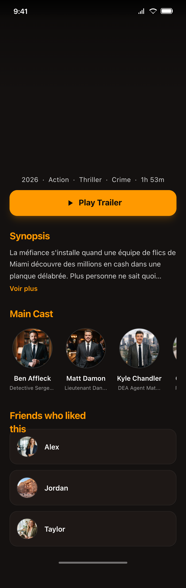
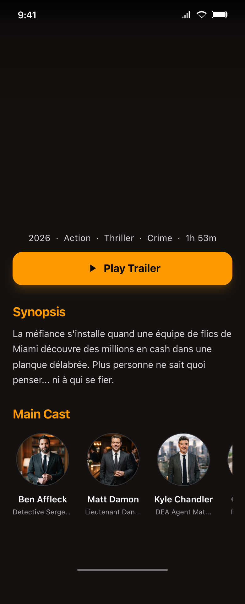

# Movie Detail module

This module has for purpose to display a movie's detail.

## Functional Specifications

#### Logic

- Detail & Video:
    - This module fetches and displays the following details: title, release date, genres, duration,
      availability, poster, overview, and main cast.
    - When overview is too long, displays an ellipse.
    - Fetches the trailer URI (supporting both YouTube and Vimeo) and caches it locally to avoid
      redundant network calls.
    - Plays the trailer movie inside the screen (modal) when clicking on the "Play trailer" button.
    - Main cast displays photo, full name, and role.

- User Interactions & Social:
    - Users can like a movie by performing a **Double Tap** on the screen.
    - Favoriting a movie synchronizes the action with the user's circle (*
      *SyncFavoriteToCircleUseCase**).
    - **Match Notification:** If the user likes a movie that is already liked by a friend, a
      Snackbar notification is triggered to alert them of the match.
    - The UI displays the list of friends who liked this movie (automatically updated via *
      *CheckMovieMatchUseCase**).

- **Cross-feature logic (Social):**
    - The UI just displays a list of friends who liked this movie - logic triggers from the `Social`
      module's domain.

#### Design & UI

The interface must be developed with Compose Multiplatform, to the mock-ups below. Use and enrich
the shared `Design` module to create reusable components. Missing on the mockups:

- Above the movie information, the movie poster should be loaded as background.
- Heart clickable symbol should be at top end (fill according to like status)

**1. Movie detail (with list of friends):**

Source HTML: [movie_detail](mockup/movie_detail.html)

**2. Movie detail (when no friend liked this movie):**

Source HTML: [movie_detail_no_friend_list](mockup/movie_detail_no_friend_list.html)

## Architecture

This module follows a Clean, Modular Architecture, designed for Kotlin Multiplatform. Each layer has
its own model. We use **Mappers** to transform data between layers.

### Presentation

Multiplatform UI and presentation logic. It contains Compose screens and ViewModels, following a
Unidirectional Data Flow (MVI-like) using UiEvents (**MovieDetailUiEventModel**). Note: UseCases
related to movies are aggregated into a **MovieDetailOrchestrator** wrapper class to simplify
ViewModel injection and respect linter recommandation. Platform-specific UI (**iosMain/swift**):
Trailer playback on iOS is handled natively using **UIKit
** and **YoutubeiOSPlayerHelper** (**YoutubePlayerViewController**). Compose Multiplatform
interoperability is used to embed this native View Contrller into the shared Compose UI. **UI State
Management:** The Compose UI utilizes a dedicated **StateContainer** handling 4 distinct states:
`Loading`, `Success`, `Error`(with retry policies), and `Empty`. **Orchestrator:**
**MovieDetailOrchestrator** aggregates various UseCases (fetching details, trailers, but also
Firebase Authentication to get the current UID and manage favorites).

### Domain

100% commonMain (pure business logic). Must not contain anything related to Android or iOS
framework. It is strictly independent of any external environment. Contains repository interfaces
(contracts) and Use Cases.

### Data

`commonMain` + `androidMain` + `iosMain`. This is where data is fetched, saved, or sent to external
sources. Contains repository implementations and maps external DTOs to Domain models. This layer
implements a Repository pattern with a single source of truth, coordinating between:

- LocalDataSource: for database caching (SQLDelight) and offline support.
- RemoteDataSource: for API calls.
- **Smart Caching:** When fetching specific remote data (e.g., trailer URIs), the Data layer formats
  it (handling both YouTube and Vimeo keys) and immediately saves it to the **LocalDataSource**.
  Subsequent requests or UI reconstructions can trigger playback instantly without redundant API
  calls.

## Technical Specifications

This feature communicates with the following modules:

- **Authentication, Movie, and Social** → This module depends heavily on their **domain** (e.g., *
  *FetchFirebaseUserInfoUseCase**, **SyncFavoriteToCircleUseCase**, ** CheckMovieMatchUseCase**).
- **Movie** → This module depends on its **domain** and **data** (for **MovieDAO** local caching and
  **Ktor** remote services).
- **Other**: Common, Database, Network, and Design modules.

## Tech Stack

- **Compose Navigation** For multiplatform navigation
- **Coil** For image loading
- **Koin** For dependency injection
- **Ktor** & **Firebase** For network calls and real-time updates
- **TMDB API** For fetching movie detail
- **YouTubeiOSPlayerHelper** (iOS) For native YouTube video playback inside the iOS application.
- **SQLDelight** For local caching (Single Source of Truth)
