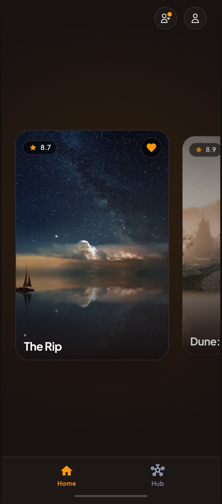

# Movies module

This module has for purpose to display movies. After a successful login or whenever an already
logged user opens the app, this is the first screen that appears.

## Functional Specifications

#### Logic

- Movie:
    - A list of movies is displayed in a horizontal and scrollable layout.
    - New data is loaded when user reaches the end of the carousel (60 items preloaded).
    - On top of the image, we find:
        - Top Start: star symbol with a number related to the popularity of the movie
        - Top End: tappable heart symbol indicating whether the user likes the movie or not
        - Bottom Start: title of the movie
    - Movie is tappable:
        - One tap: redirecting to the movie detail in another screen
        - Double tap: like/unlike movie according to initial state
    - When a user likes/unlikes a movie, the action is saved locally first for immediate UI
      feedback, and then synced to the remote database (**SyncLocalFavoritesToCloudUseCase**).
    - The app **always** checks if any data is available in cache. If not, it is fetched from the
      TMDB API and then cached.
    - Smart Caching: The app evaluates if the local cache is outdated (older than 23 hours via *
      *ShouldRefreshMoviesUseCase**) before fetching new data in the background.
    - Pagination: Uses `DataStore` (**MovieSyncPreferences**) to keep track of the last loaded page
      and seamlessly loads more items when reaching the end of the carousel.
    - Social Match Animation: If a user likes a movie (Double tap) that a friend has already liked,
      it triggers a dedicated Match Animation UI Event (`MatchAnimationData`) displaying the uer's
      and matching friends' avatars.
- Image Caching & Offline Support:
    - Movie posters are fetched from the TMDB API and securely downloaded to the device's local
      storage.
    - The app checks if the image already exists locally before making a network request, optimizing
      bandwidth and allowing smooth offline viewing of already loaded movies.
- Other:
    - Screen displays a top bar with two icons at the top end (from left to right):
        - Social: Navigates to the social circle / invitations screen.
        - Profile: Navigates to the user's profile screen.

- **Cross-feature logic (Social):**
    - The UI allows interaction through a top bar with the social part (sent and received
      invitations) which triggers logic from the `Social` module's domain.

- **Cross-feature logic (Profile):**
    - The UI allows interaction through a top bar with the profile part which triggers logic from
      the `Profile` module's domain.

- **Cross-feature logic (Hub):**
    - The UI allows interaction through a navigation bottom bar with two tabs: Home (this screen)
      and Hub which triggers logic from the `Hub` module's domain.

#### Design & UI

The interface must be developed with Compose Multiplatform, strictly to the mock-ups below. Use and
enrich the shared `Design` module to create reusable components.

**1. Movie list:**

Source HTML: [movie_list](mockup/movie_list.html)

## Architecture

This module follows a Clean, Modular Architecture, designed for Kotlin Multiplatform. Each layer has
its own model. We use **Mappers** to transform data between layers.

### Presentation

Multiplatform UI and presentation logic. It contains Compose screens and ViewModels, following a
Unidirectional Data Flow (MVI-like) using UiEvents (**MovieEventModel**). Note: UseCases related to
movies are aggregated into a **MovieCatalogOrchestrator** wrapper class to simplify ViewModel
injection and respect linter recommandation. Any UseCases related to user action on this screen is
wrapped with **MovieUserActionOrchestrator**.

### Domain

100% commonMain (pure business logic). Must not contain anything related to Android or iOS
framework. It is strictly independent of any external environment. Contains repository interfaces
(contracts) and Use Cases.

### Data

`commonMain` + `androidMain` + `iosMain`. This is where data is fetched, saved, or sent to external
sources. Contains repository implementations and maps external DTOs to Domain models. This layer
implements a Repository pattern with a single source of truth, coordinating between:

- LocalDataSource: for database caching (SQLDelight) and offline support.
- RemoteDataSource: for API calls.
- Platform-specific File System (androidMain / iosMain): Uses native APIs (**HttpURLConnection**/
  **Bitmap** for Android, **NSURLSession**/ **NSFileManager** for iOS) within
  **ImageRepositoryImpl**
  to download and aggressively cache TMDB images locally. d
- DataStore Preferences: Used to persist local synchronization metadata (e.g., last sync timestamp,
  last loaded page) for smart caching and pagination operations (**MovieSyncPreferences**).
- Network Connectivity: Uses a **NetworkConnectivityChecker** to ensure remote sync operations (like
  pushing favorites to Firestore) only occur when the network is available, gracefully handling
  offline scenarios.

## Technical Specifications

This feature communicates with the following modules:

- **Authentication and Social** → This module depends on their **domain**.
- **Other**: Common, Database, Network, and Design modules.

## Tech Stack

- **Compose Navigation** For multiplatform navigation
- **Coil** For image loading
- **Koin** For dependency injection
- **Ktor** & **Firebase** For network calls and real-time updates
- **TMDB API** For fetching movies catalog and details
- **Firebase Database** For storing/fetching remote data
- **SQLDelight** For local caching (Single Source of Truth)
- **DataStore Preferences** For storing key-value pairs (sync timestamps, pagination state) locally
