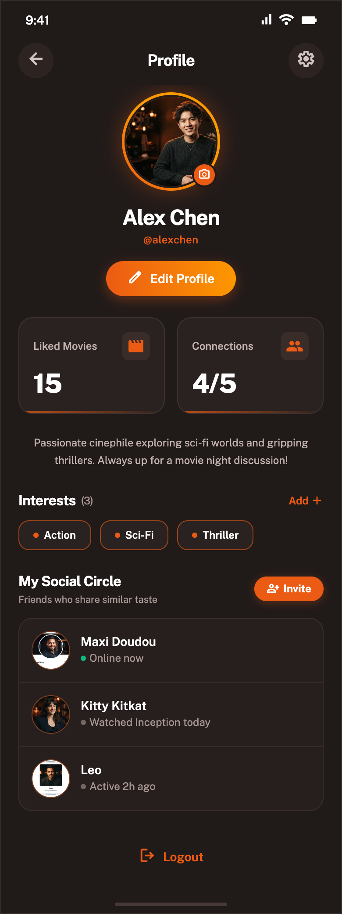
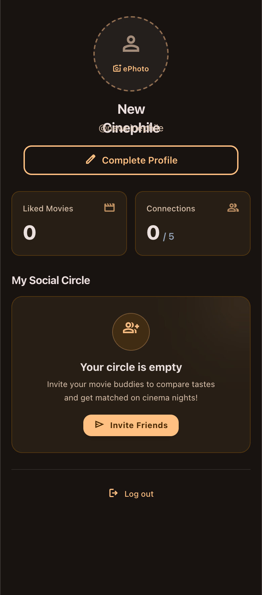
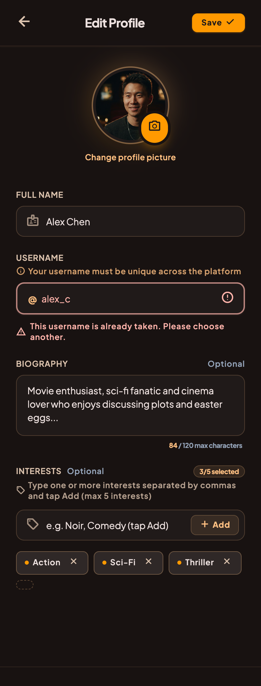

# Profile module

The purpose of this module is to manage everything related to the user's profile such as its avatar,
pseudo, biography, social circle, etc...

## Functional Specifications

#### Logic

- Reading
    - At sign-in (and at each launch from the splash), the profile is hydrated from Firestore into
      the local database (**HydrateUserProfileUseCase**), so a reinstall or new device restores the
      pseudo. A default local profile is created when there is no remote profile yet.
    - **Mandatory pseudo step**: a signed-in user without a pseudo is sent to the **PickPseudo**
      screen (after sign-up, after a sign-in that finds no pseudo, or from the splash) and cannot
      reach the app until one is reserved. Guests skip it. If the remote lookup fails (offline), the
      user is let in and the splash checks again on the next launch.
    - The profile displays:
        - an avatar (or placeholder when empty)
        - user's name
        - two spaces: the number of movies liked and the number of connexions made (up to 5)
        - user's interests - if empty, it doesn't display
        - user's social circle: displays friends and specifically calculates _the number of movies
          in common_ with each friend (**ComputeCommonMoviesUseCase**).
    - The profile data is fully reactive: the UI observes a local stream (*
      *ObserveCurrentUserProfileStateUseCase**) which is dynamically tied to the active session (*
      *ObserveSessionStateUseCase**).

- Edition
    - Offline-first approach: Edits are instantly saved locally for immediate UI feedback (*
      *UpsertUserUseCase**), and synchronized to the remote database in the background (*
      *SyncUserUseCase**).
    - User can pick a profile picture from their gallery. The app automatically caches the new image
      and _cleans up the old local avatar_ to save device storage (**ImageManager**).
    - The pseudo is chosen once on the PickPseudo screen and is read-only afterwards (invites are
      keyed by pseudo). Rules (**PseudoValidator**): 3–20 characters, letters/digits/`_`/`.`, not
      starting or ending with a dot.
    - Availability is checked live (debounced) and case-insensitively (**IsPseudoAvailableUseCase**),
      but uniqueness is enforced by a Firestore transaction on the `pseudos/{pseudoLowercase}`
      reservation doc (**ReservePseudoUseCase**).
    - The profile header shows `@pseudo` with a copy action so users can share it.
    - User can add a biography - up to 120 characters (optional)
    - User can add interests (optional) - up to 5.

- **Cross-feature logic (Log out):**
    - The UI provides a logout button, but the logic is delegated to the `Authentication` module

- **Cross-feature logic (Delete account):**
    - A "Delete my account" destructive text button sits at the very bottom of the profile (view
      mode only), below Log out, and opens a confirmation dialog.
    - The logic lives in the `Authentication` module (**DeleteAccountUseCase**), called through
      **UserProfileOrchestrator**. It first checks the sign-in is recent (Firebase requires it): if
      not, nothing is deleted and the user is asked to sign in again
      (`AppError.Authentication.RecentLoginRequired`).
    - Then it deletes, in one Firestore batch: the user's `users/{uid}` document, both sides of
      every circle entry, and all invitations sent or received. Then the Storage avatar, the
      Firebase Auth user, the provider sessions, and finally all local user data (SQLDelight wipe +
      session flags + cached avatar file).

- **Cross-feature logic (Removing a member):**
    - The UI allows interaction with the social circle (e.g. removing a member) which triggers logic
      from the `Social` module's domain.

#### Design & UI

The interface must be developed with Compose Multiplatform, strictly to the mock-ups below. Use and
enrich the shared `Design` module to create reusable components.

**1. User Profile (With data):**

Source HTML: [profile_completed](mockup/profile_completed.html)

**2: User Profile (Empty state):**

Source HTML: [profile_empty](mockup/profile_empty.html)

**3. User Profile Edition:**

Source HTML: [profile_edition](mockup/profile_edition.html)

## Architecture

This module follows a Clean, Modular Architecture, designed for Kotlin Multiplatform. Each layer has
its own model. We use **Mappers** to transform data between layers.

### Presentation

Multiplatform UI and presentation logic. It contains Compose screens and ViewModels, following a
Unidirectional Data Flow (MVI-like) using UiEvents (**UserProfileUiEventModel**).
Note: All UseCases are aggregated into a single **UserProfileOrchestrator** wrapper class to
simplify ViewModel injection and respect linter recommandation.
Edit Mode State Management: The ViewModel utilizes dual state streams (`editableProfile` and
`originalProfile`) to handle modifications seamlessly, allowing users to safely discard unsaved
changes without triggering new database queries.
Dynamic Session Handling: The ViewModel listens to the Authentication state to ensure the displayed
profile dynamically matches the currently logged-in user (`currentUserUid`).

### Domain

100% commonMain (pure business logic). Must not contain anything related to Android or iOS
framework. It is strictly independent of any external environment. Contains repository interfaces (
contracts) and Use Cases.
Handles specific domain states like **UserProfileNoCircleDomainModel** to separate profile data from
social graph data.

### Data

`commonMain` + `androidMain` + `iosMain`. This is where data is fetched, saved, or sent to external
sources. Contains repository implementations and maps external DTOs to Domain models.
This layer implements a Repository pattern with a single source of truth, coordinating between:

- LocalDataSource: for caching and offline support.
- RemoteDataSource: for API calls.
- Pseudo reservation: `reservePseudo` writes `pseudos/{pseudoLowercase}` and
  `users/{uid}.information.{name, pseudo, pseudoLowercase}` in one transaction. Profile syncs never
  touch the pseudo fields. `pseudoLowercase` is what search queries use.

## Technical Specifications

This feature communicates with the following modules:

- **Session, Authentication, Movie, and Social** → This module depends on their **domain**.
- **Other**: Common, Database, Network, and Design modules.

## Tech Stack

- **Compose Navigation** For multiplatform navigation
- **Coil** For image loading
- **Koin** For dependency injection
- **Ktor** & **Firebase** For network calls and real-time updates
- **Firebase Database** For storing/fetching remote data
- **Firebase Storage** For uploading and storing user profile picture
- **SQLDelight** For local caching (Single Source of Truth)
