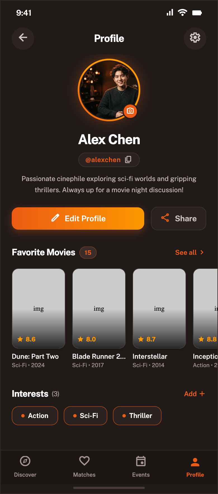
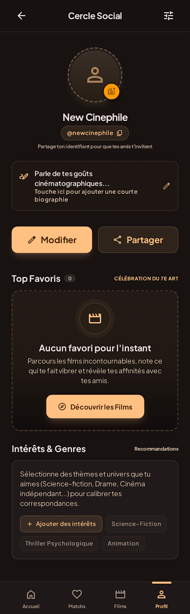
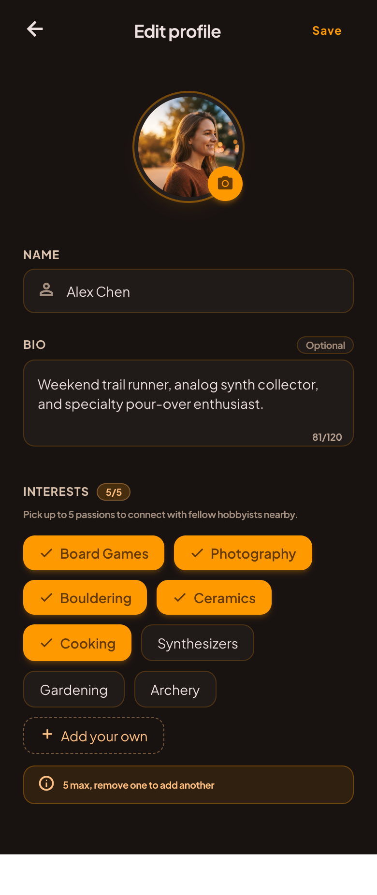
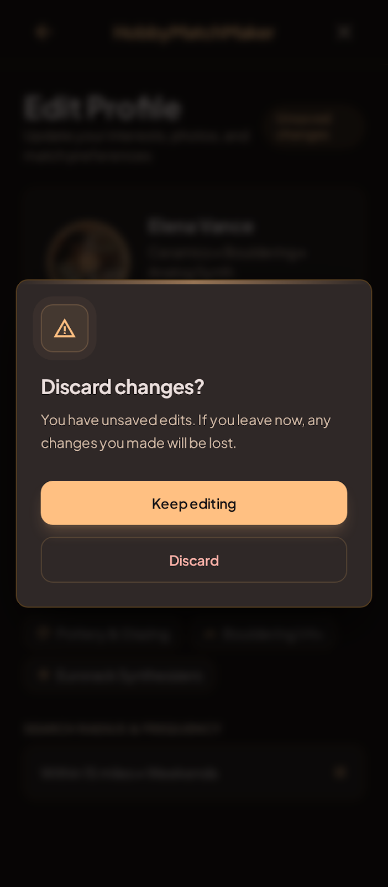

# Profile module

The purpose of this module is to manage everything related to the user's profile such as its avatar,
pseudo, biography, interests and a preview of their favorites. Friends and invitations live in the
`Social` module, and account actions (log out, delete account, report) in the `Settings` module.

## Functional Specifications

#### Logic

- Reading
    - At sign-in (and at each launch from the splash), the profile is hydrated from Firestore into
      the local database (**HydrateUserProfileUseCase**), so a reinstall or new device restores the
      pseudo. A default local profile is created when there is no remote profile yet.
    - **Mandatory pseudo step**: a signed-in user without a pseudo is sent to the **PickPseudo**
      screen (after sign-up, after a sign-in that finds no pseudo, or from the splash) and cannot
      reach the app until one is reserved. Guests skip it. If the remote lookup fails (offline), the
      user is let in and the splash checks again on the next launch.
    - The profile displays, top to bottom:
        - an avatar with a camera badge (dashed placeholder when there is no photo). Tapping it, or
          the badge, opens the edit screen.
        - the name, and the `@pseudo` in a pill: tapping it copies the pseudo to the clipboard.
        - the bio, or a tappable "tell us about your tastes" card when it is empty.
        - a **Share** button (system share sheet with a message containing the pseudo, via
          `rememberShareText`) and an **Edit profile** button.
        - **Favorites**: the total count and a strip of the latest favorites (up to 8, poster and
          title, newest first, **ObserveFavoriteMoviesUseCase**). Tapping a poster opens its detail.
          "See all" and the empty-state "Discover" button both go back to the main screen (it
          cannot select the Hub tab from outside the tab navigation yet).
        - **Interests** with their count and an "Add" action, or an invitation card when empty.
        - a gear in the top bar that opens Settings. Guests see a dedicated sign-up layout instead.
    - The profile data is fully reactive: the UI observes a local stream
      (**ObserveCurrentUserProfileStateUseCase**) combined with the liked count and the favorites,
      dynamically tied to the active session (**ObserveSessionStateUseCase**). If the observation
      fails, an error screen offers a working Retry that restarts it.

- Edition
    - Offline-first approach: edits are saved locally first (**UpsertUserProfileUseCase**) and
      synchronized to Firestore right after (**SyncUserProfileUseCase**). If the remote sync fails, a
      snackbar says it was saved on this device only; there is no automatic retry yet.
    - **Profile photo:** picking a photo from the gallery only shows a preview. It is uploaded to
      Firebase Storage (`avatars/{uid}/avatar.jpg`) when the user taps **Save**. Cancel or Discard
      leave the online photo untouched. If the upload fails, the user stays in edit mode with a
      message (offline, not allowed, or a service error).
    - **Name:** required, trimmed, no digits, 40 characters max.
    - **Bio:** optional, 120 characters max, with a counter.
    - **Interests:** up to 5, picked from localized suggestions (tap to toggle) or added as a single
      custom tag (20 characters max, case-insensitive de-duplication). Stored as plain strings.
    - **The pseudo is not shown in the edit screen.** It is chosen once on the PickPseudo screen and
      is read-only afterwards (invites are keyed by pseudo). Rules (**PseudoValidator**): 3–20
      characters, letters/digits/`_`/`.`, not starting or ending with a dot.
    - Availability is checked live (debounced) and case-insensitively (**IsPseudoAvailableUseCase**),
      but uniqueness is enforced by a Firestore transaction on the `pseudos/{pseudoLowercase}`
      reservation doc (**ReservePseudoUseCase**).
    - **Save** is enabled only when something changed and the name is valid. While saving it shows a
      spinner and ignores further taps. A successful save closes edit mode and shows "Profile
      updated".
    - **Leaving with unsaved changes** (top-bar back, Android system back) opens a "Discard
      changes?" dialog where "Keep editing" is the emphasized action. Without changes, back leaves
      directly. iOS has no system back, only the arrow.

- **Cross-feature logic (Settings):**
    - Log out, Delete account and Report a problem moved to the `Settings` module (opened from the
      gear in the profile top bar). See `features/settings/README.md`.

#### Design & UI

The interface must be developed with Compose Multiplatform, strictly to the mock-ups below. Use and
enrich the shared `Design` module to create reusable components.

**1. User Profile (With data):**

Source HTML: [profile_completed](mockup/profile_completed.html)

**2: User Profile (Empty state):**

Source HTML: [profile_empty](mockup/profile_empty.html)

**3. User Profile Edition:**

Source HTML: [profile_edition](mockup/profile_edition.html)

**4. User Profile Edition - Discarding save:**

Source HTML: [discard_edition](mockup/profile_edition_discard.html)

Differences from the mock-ups (the `.png` wins otherwise):

- Only the **dialog** of the discard mock-up is a reference. Its background shows an older design
  (search radius, match preferences, hobby tags) that does not exist in the app.
- Favorite posters show only the poster and the title (no year, rating or genre).
- Buttons use the plain primary color (no gradient). On the profile, **Share** is the filled button
  and **Edit profile** the outlined one.
- The edit screen has no pseudo field, and interest suggestions mix movie genres with a few hobbies.
- The empty profile's suggested interest chips and the bottom navigation bars of the mock-ups are not
  implemented as such (the app has its own tab bar).

## Architecture

This module follows a Clean, Modular Architecture, designed for Kotlin Multiplatform. Each layer has
its own model. We use **Mappers** to transform data between layers.

### Presentation

Multiplatform UI and presentation logic. It contains Compose screens and ViewModels, following a
Unidirectional Data Flow (MVI-like) using UiEvents (**UserProfileUiEventModel**).
Note: All UseCases are aggregated into a single **UserProfileOrchestrator** wrapper class to
simplify ViewModel injection and respect linter recommandation.
Edit Mode State Management: The ViewModel utilizes dual state streams (`editableProfile` and
`originalProfile`) to handle modifications seamlessly. `isDirty` (editable differs from original)
drives the Save button and the discard dialog, and `isSaving` guards against double taps. A picked
photo stays a preview (`pendingAvatarSource`) until Save, so discarding never touches storage.
Dynamic Session Handling: The ViewModel listens to the Authentication state to ensure the displayed
profile dynamically matches the currently logged-in user (`currentUserUid`).

### Domain

100% commonMain (pure business logic). Must not contain anything related to Android or iOS
framework. It is strictly independent of any external environment. Contains repository interfaces (
contracts) and Use Cases.
Handles specific domain states like **UserProfileNoCircleDomainModel** to separate profile data from
social graph data.

### Data

`commonMain` + `androidMain` + `iosMain`. This is where data is fetched, saved, or sent to external
sources. Contains repository implementations and maps external DTOs to Domain models.
This layer implements a Repository pattern with a single source of truth, coordinating between:

- LocalDataSource: for caching and offline support.
- RemoteDataSource: for API calls.
- Pseudo reservation: `reservePseudo` writes `pseudos/{pseudoLowercase}` and
  `users/{uid}.information.{name, pseudo, pseudoLowercase}` in one transaction. Profile syncs never
  touch the pseudo fields. `pseudoLowercase` is what search queries use.

## Technical Specifications

This feature communicates with the following modules:

- **Session, Authentication and Movie** → This module depends on their **domain** (Movie for the
  favorites strip, Authentication for the PickPseudo sign-out). It no longer depends on `Social`.
- **Other**: Common, Database, Network, and Design modules.

## Tech Stack

- **Compose Navigation** For multiplatform navigation
- **Coil** For image loading
- **Koin** For dependency injection
- **Ktor** & **Firebase** For network calls and real-time updates
- **Firebase Database** For storing/fetching remote data
- **Firebase Storage** For uploading and storing user profile picture
- **SQLDelight** For local caching (Single Source of Truth)
