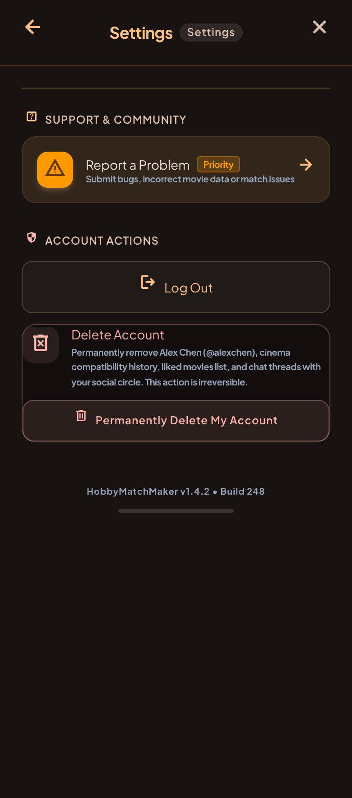

# Settings module

Account and support screen, opened from the gear icon in the Profile top bar.

## Features

- **Report a problem**: opens the support email (`supportMailtoUri`). This is also the child-safety
  contact path required by Google Play, so it must stay reachable.
- **Privacy policy**: opens `PRIVACY_POLICY_URL` (Firebase Hosting). Google Play requires the policy
  to be reachable from inside the app.
- **Log out**: signs the user out and returns to the sign-in screen.
- **Delete account**: asks for confirmation (existing destructive dialog), then deletes the account,
  the local avatar file and returns to the sign-in screen. Google Play requires deletion to be easy to find.
- **Version line**: the real version name and build number, read from the platform (`AppInfo`).

Not done yet: a **Blocked users** row to undo a block. It needs its own mockup first.

#### Design & UI

The interface must be developed with Compose Multiplatform, to the mock-up below. Use and
enrich the shared `Design` module to create reusable components.

**Settings:**

Source HTML: [settings.html](mockup/settings.html)

Differences from the mock-up (the `.png` wins otherwise):

- No duplicate "Settings" chip, no close (X) icon and no "Priority" tag. Back arrow on iOS only.
- The delete card is a single tappable card that opens the confirmation dialog, and its text is the
  existing `delete_account_dialog_message` (the app has no chat).
- Hobby-neutral wording ("a data issue" instead of "incorrect movie data").
- Extra row for the privacy policy, which the mock-up does not have.

## Architecture

- No data layer and no domain layer: it only wraps existing use cases (log out, delete account,
  current profile avatar) from `core/authentication`, `core/session` and `features/profile` domains.
- presentation/ # `SettingsViewModel`, `SettingsOrchestrator`, `SettingsContent`
