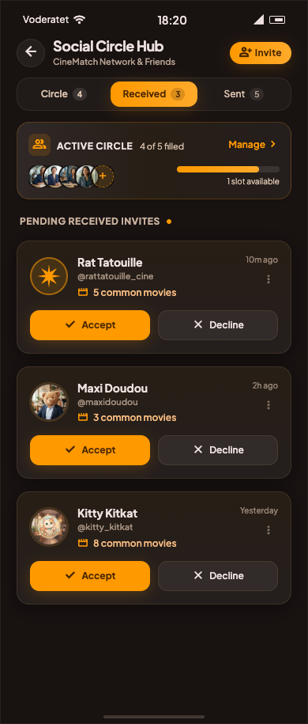
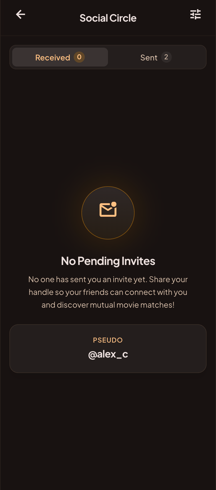
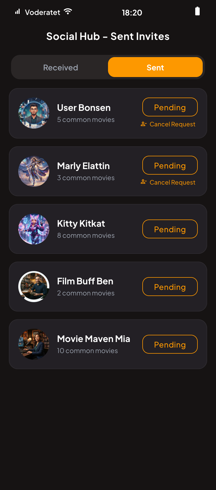
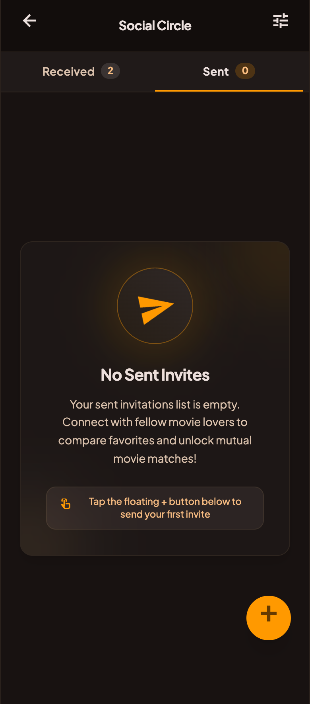

# Social module

The purpose of this module is to manage everything related to the user's social circle (friends,
invitations, and shared interests).

## Functional Specifications

#### Logic

The Social screen has a header (title, iOS back arrow, **Invite** button), an **Active Circle** card
(filled slots out of 5, progress, slots left) and three tabs with a count: **Circle**, **Received**
and **Sent**. The circle is capped at `MAX_SOCIAL_CIRCLE_SIZE` (5) members.

- **Circle tab**
    - Lists the members (avatar, name, `@pseudo`, number of favorites in common) and dashed empty
      slots. The first empty slot, and the empty state, have an **Invite** button.
    - Each member has a `⋮` menu: **Remove from circle**, **Report** and **Block**. Remove and Block
      ask for a confirmation; Report opens a dialog with 5 reasons (spam, harassment, fake profile,
      inappropriate content, other).
    - **Remove** deletes both circle entries and the invites in both directions in one batch, so
      either person can invite again later (**RemoveMemberUseCase**).
    - **Block** (`users/{uid}/blocked/{blockedUid}`) does the same as remove and also hides the
      person from search and from incoming invites. People who blocked you are hidden from your
      search too.
    - **Report** writes to the create-only `reports` collection (reporter, reported user, reason,
      date). Reports are reviewed by hand in the Firebase console, nothing alerts on new ones.
    - There is no screen yet to **unblock** someone (the use case exists, see the Settings README).
- **Received tab**
    - Pending invitations with the sender's name, avatar and favorites in common. The user can
      accept, or decline after a confirmation. Cards have a `⋮` menu with **Report** and **Block**.
    - **Limit enforcement:** before accepting, the app verifies that **both** the sender and the
      receiver are under the circle limit (**CheckSocialCircleLimitUseCase**). If full, a
      capacity-reached message is shown.
- **Sent tab**
    - Pending and declined invitations, newest first. Pending ones can be cancelled, declined ones
      can be dismissed (`senderDismissed`). Accepted invites are not listed: the person is in the
      circle.
    - A declined invite cannot be sent again for **30 days** (`declinedAt`, enforced both in the app
      and in the Firestore rules). Sending to someone already pending or accepted is refused
      (`AppError.Social`).
- **Invite dialog** (from the header, an empty slot or the empty state)
    - Searches by pseudo with a 300 ms debounce, lowercase prefix matching, 10 results max. Circle
      members are hidden, people already invited are greyed out, and a full circle shows an
      explanation instead of the dialog.
    - Every signed-in user has a pseudo (mandatory PickPseudo step), so everyone can be found.
      Sending an invite without a pseudo fails with `AppError.Profile.PseudoMissing` as a safeguard.
- Each accept, decline, cancel, remove, block and report has a busy state (no double taps) and a
  success or error snackbar.
- The data flow is reactive: the UI observes local data streams while refreshes from Firestore run
  in the background. The circle and the invites are refreshed when the app starts for a signed-in
  user (**RefreshSocialCircleUseCase**, **RefreshIncomingInvitesUseCase**,
  **RefreshSentInvitesUseCase**). Retry on an error state restarts the observers.

- **Cross-feature logic (Movie matching & synchronization):**
    - When the user likes a movie (triggered externally), this feature dynamically checks if the
      movie is also liked by a member of their social circle (**CheckMovieMatchUseCase**).
    - To enable fast matching, liked movies are directly duplicated and synchronized within each
      circle connection (`UpdateMovieLikedInCircleEntries`).
- **Cross-feature logic (Navigation):**
    - The Movies top bar icon shows a badge with the number of pending invitations.
    - The Hub's "no recent matches" card leads here, and guests are sent to sign-up instead.

#### Design & UI

The interface must be developed with Compose Multiplatform, strictly to the mock-ups below. Use and
enrich the shared `Design` module to create reusable components.

**1. Received invitations (With data):**

Source HTML: [social_circle_received_invites](mockup/social_circle_received_invites.html)

**2: Received invitations (Empty state):**

Source HTML: [social_circle_received_invites_empty_state](mockup/social_circle_received_invites_empty_state.html)

**3. Sent invitations (With data):**

Source HTML: [social_circle_sent_invites](mockup/social_circle_sent_invites.html)

**4. Sent invitations (Empty state):**

Source
HTML: [social_circle_sent_invites_empty_state](mockup/social_circle_sent_invites_empty_state.html)

The Circle tab, the invite dialog and the Active Circle card have no dedicated mock-up of their own:
they follow the hidden overlays and the header of the **Sent** HTML. Differences from the mock-ups:
the "Network & Friends" and "Inner Circle" labels, the "share quick invite link" row and the
notification promises are not implemented, and the Active Circle card sits below the tabs so the
tabs never move.

## Architecture

This module follows a Clean, Modular Architecture, designed for Kotlin Multiplatform. Each layer has
its own model. We use **Mappers** to transform data between layers.

### Presentation

Multiplatform UI and presentation logic. It contains Compose screens and ViewModels, following a
Unidirectional Data Flow (MVI-like) using UiEvents (**SocialUiEventModel**).

### Domain

100% commonMain (pure business logic). Must not contain anything related to Android or iOS
framework. It is strictly independent of any external environment. Contains repository interfaces
(contracts) and Use Cases. Note: All UseCases are aggregated into a single **SocialUseCases**
wrapper class to simplify ViewModel injection.

### Data

`commonMain` + `androidMain` + `iosMain`. This is where data is fetched, saved, or sent to external
sources. Contains repository implementations and maps external DTOs to Domain models. This layer
implements a Repository pattern with a single source of truth, coordinating between:

- LocalDataSource: for caching and offline support.
- RemoteDataSource: for API calls.
- **Atomic Transactions:** Accepting an invitation uses a Firestore Transaction (
  `firestore.runTransaction`) to atomically update the invite status and seamlessly insert each user
  into the other's social circle subcollection. This ensures complete data consistency.
- **Optimized Queries:**
    - Search relies on a `pseudoLowercase` field for case-insensitive queries, combined with
      Firestore's `\uf88ff` end-term trick for efficient prefix matching.
    - Social invites use a composite deterministic Document ID (`${fromUid}_${toPseudo}`) to prevent
      duplicate invitations inherently at the database level.

## Technical Specifications

This feature communicates with the following modules:

- **User, Session and Profile** → This module depends on their **domain**. The Profile module no
  longer depends on `Social`.
- **Other**: Common, Database, Network, and Design modules.

## Tech Stack

- **Compose Navigation** For multiplatform navigation
- **Coil** For image loading
- **Koin** For dependency injection
- **Ktor** & **Firebase** For network calls and real-time updates
- **Firebase Database** For storing/fetching remote data
- **SQLDelight** For local caching (Single Source of Truth)
