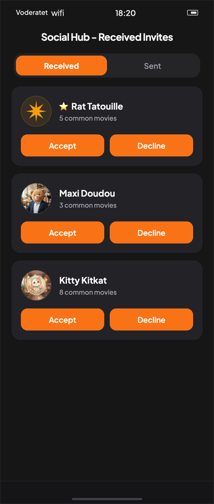
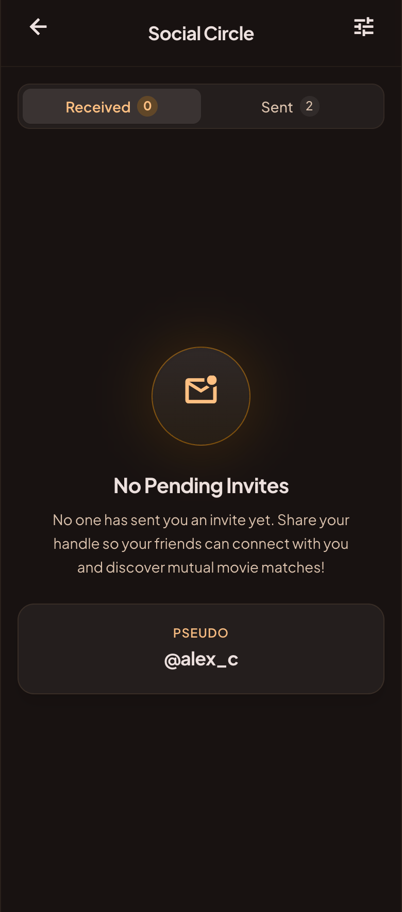
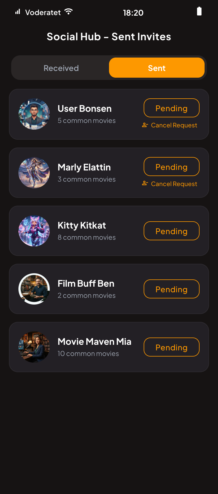
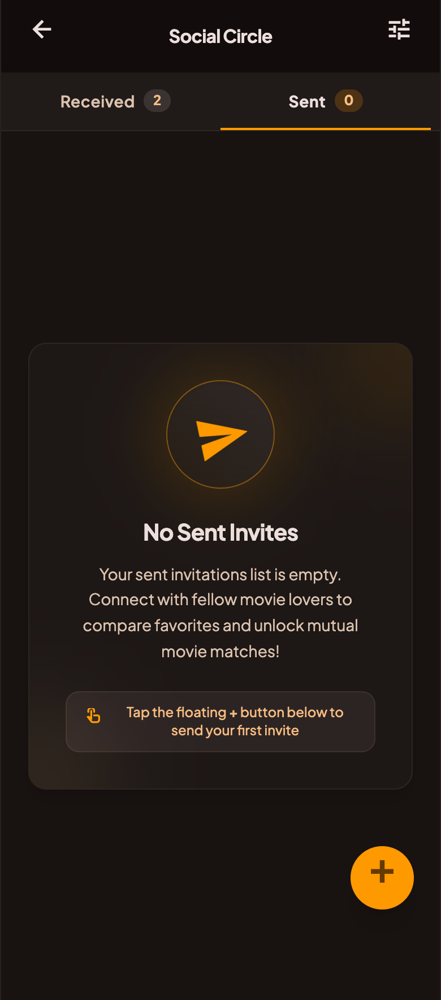

# Social module

The purpose of this module is to manage everything related to the user's social circle (friends,
invitations, and shared interests).

## Functional Specifications

#### Logic

- A specific top bar is displayed, separated into two tabs:
    - **Received tab**:
        - The user receives a list of pending invitations.
        - The user can accept or reject them directly from this tab.
        - **Limit enforcement:** Before accepting an invitation, the app strictly verifies that *
          *both** the sender and the receiver have not exceeded the maximum social circle limit of 5
          members (**CheckSocialCircleLimitUseCase**). If full, a capacity-reached feedback is
          triggered.
    - **Sent & Search tab**:
        - The user can track the status of the invitations they sent and cancel them if needed.
        - The user can search for someone using a pseudo. The search is optimized using a lowercase
          prefix matching system and limits the results to 10 pertinent profiles to save bandwidth.
        - The user can add up to 5 people to their social circle.
        - The data flow is highly reactive: the UI observes local data streams while background
          syncs (refreshes) are performed with the remote server.

- **Cross-feature logic (Movie matching & synchronization):**
    - When the user likes a movie (triggered externally), this feature dynamically checks if the
      movie is also liked by a member of their social circle (**CheckMovieMatchUseCase**).
    - To enable fast matching, liked movies are directly duplicated and synchronized within each
      circle connection (`UpdateMovieLikedInCircleEntries`).

- **Cross-feature logic (Profile interaction):**
    - The logic to remove an existing member from the social circle is handled by this module
      (RemoveMemberUseCase), but the **UI triggering this action is located in the user `Profile`
      module**.

#### Design & UI

The interface must be developed with Compose Multiplatform, strictly to the mock-ups below. Use and
enrich the shared `Design` module to create reusable components.

**1. Received invitations (With data):**

Source HTML: [social_circle_received_invites](mockup/social_circle_received_invites.html)

**2: Received invitations (Empty state):**

Source HTML: [social_circle_received_invites_empty_state](mockup/social_circle_sent_invites_empty_state.html)

**3. Sent invitations (With data):**

Source HTML: [social_circle_sent_invites](mockup/social_circle_sent_invites.html)

**4. Sent invitations (Empty state):**

Source
HTML: [social_circle_sent_invites_empty_state](mockup/social_circle_sent_invites_empty_state.html)

## Architecture

This module follows a Clean, Modular Architecture, designed for Kotlin Multiplatform. Each layer has
its own model. We use **Mappers** to transform data between layers.

### Presentation

Multiplatform UI and presentation logic. It contains Compose screens and ViewModels, following a
Unidirectional Data Flow (MVI-like) using UiEvents (**SocialUiEventModel**).

### Domain

100% commonMain (pure business logic). Must not contain anything related to Android or iOS
framework. It is strictly independent of any external environment. Contains repository interfaces
(contracts) and Use Cases. Note: All UseCases are aggregated into a single **SocialUseCases**
wrapper class to simplify ViewModel injection.

### Data

`commonMain` + `androidMain` + `iosMain`. This is where data is fetched, saved, or sent to external
sources. Contains repository implementations and maps external DTOs to Domain models. This layer
implements a Repository pattern with a single source of truth, coordinating between:

- LocalDataSource: for caching and offline support.
- RemoteDataSource: for API calls.
- **Atomic Transactions:** Accepting an invitation uses a Firestore Transaction (
  `firestore.runTransaction`) to atomically update the invite status and seamlessly insert each user
  into the other's social circle subcollection. This ensures complete data consistency.
- **Optimized Queries:**
    - Search relies on a `pseudoLowercase` field for case-insensitive queries, combined with
      Firestore's `\uf88ff` end-term trick for efficient prefix matching.
    - Social invites use a composite deterministic Document ID (`${fromUid}_${toPseudo}`) to prevent
      duplicate invitations inherently at the database level.

## Technical Specifications

This feature communicates with the following modules:

- **User, Session and Profile** → This module depends on their **domain**. Conversely, the Profile
  module depends on the `Social` domain to trigger specific actions (like removing a member via *
  *RemoveMemberUseCase**).
- **Other**: Common, Database, Network, and Design modules.

## Tech Stack

- **Compose Navigation** For multiplatform navigation
- **Coil** For image loading
- **Koin** For dependency injection
- **Ktor** & **Firebase** For network calls and real-time updates
- **Firebase Database** For storing/fetching remote data
- **SQLDelight** For local caching (Single Source of Truth)
